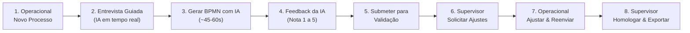

# Guia Rápido do Avaliador · Piloto Controlado FluxoIA
**Documento de Apoio ao Piloto F4.DO1 · Fábrica de IA (UFPI / INOVATHE)**  
*Tópicos em Inteligência Computacional & Engenharia de Software para Sistemas Inteligentes*

---

## 1. Ambiente e Credenciais de Acesso

Acesse o sistema diretamente pelo navegador:  
👉 **URL do Piloto:** [http://185.174.255.122/](http://185.174.255.122/)

| Perfil de Teste | E-mail de Acesso | Senha Padrão | Setor Vinculado | Papel no Teste |
| :--- | :--- | :--- | :--- | :--- |
| **Participante A (Operacional)** | `operacional@ufpi.edu.br` | `FluxoIA@2026` | Protocolo Geral | Cadastra o processo, responde à entrevista guiada, aciona a IA e submete para governança. |
| **Participante B (Supervisor)** | `supervisor@ufpi.edu.br` | `FluxoIA@2026` | Protocolo Geral | Analisa o fluxo na fila de governança, solicita ajustes e homologa/aprova o processo final. |

> [!TIP]
> **Dica de operação:** Recomendamos abrir duas abas no navegador (ou uma janela normal e outra anônima) para alternar rapidamente entre a visão do **Operacional** e a visão do **Supervisor**.

---

## 2. Missões de Teste da IA e Governança

Para explorar a inteligência do sistema e vivenciar o ciclo de homologação completo, cumpram as seguintes missões durante a sessão:

* 🎯 **Missão 1 (Testar o Validador de IA em Tempo Real):**  
  Em pelo menos uma das perguntas da entrevista, digite de propósito uma resposta curta ou vaga (ex: *"o setor analisa e depois avisa"*). Observe a IA intervir com um alerta âmbar contendo uma dica de melhoria. Experimente tanto complementar a resposta quanto clicar em *"Manter resposta assim mesmo"*.
* 🎯 **Missão 2 (Exercitar o Ciclo de Devolução e Ajustes):**  
  Após a primeira submissão, o **Supervisor** deve deliberadamente recusar o diagrama clicando em **"Solicitar Ajustes"** e registrando um parecer técnico (ex: *"Favor esclarecer os critérios de desempate de vagas na DAA"*). O **Operacional** deve reabrir o processo, fazer um ajuste/regeneração e reenviar, gerando a versão incrementada (**v1.0.1**).
* 🎯 **Missão 3 (Inspecionar a Fidelidade da Ficha Técnica):**  
  No rodapé do BPMN gerado, inspecionem os cartões de **Prazos**, **Sistemas** e **Documentação**. Verifiquem se a IA capturou os dados informados (como SIPAC e SIGAA) sem inventar prazos arbitrários ou sistemas não citados.
* 🎯 **Missão 4 (Testes de Interatividade e Exportação):**  
  - No editor BPMN, experimente arrastar e reposicionar caixas no canvas para testar o ajuste fino manual;
  - Teste baixar o arquivo **.bpmn** e o **PDF Institucional** gerado para checar a formatação final;
  - No painel do Supervisor, tente submeter um parecer vazio para conferir a trava de segurança da governança.

---

## 3. Checklist Prático Ponta a Ponta



- [ ] **1. Operacional:** Login com `operacional@ufpi.edu.br`. Clique em **"+ Novo Processo"**, preencha os dados iniciais (conforme a Referência da UFPI abaixo) e inicie a entrevista.
- [ ] **2. Operacional:** Responda às perguntas no chat com o assistente (cumprindo a **Missão 1**).
- [ ] **3. Operacional:** Clique em **"Gerar BPMN com IA"** e aguarde o processamento (~45 a 60 segundos).
- [ ] **4. Operacional:** Inspecione o diagrama e a ficha técnica. Na **Etapa 4 (Feedback da IA)**, atribua as notas de 1 a 5 e clique em **"Submeter para Validação"**.
- [ ] **5. Supervisor:** Login com `supervisor@ufpi.edu.br` em outra aba/janela. Acesse **"Validação & Governança"** e abra o processo.
- [ ] **6. Supervisor:** Clique em **"Solicitar Ajustes"**, digite o parecer e devolva o processo (**Missão 2**).
- [ ] **7. Operacional:** No perfil Operacional, observe o status *Ajustes Solicitados*, faça a revisão/regeneração e clique em **"Reenviar para Validação"**.
- [ ] **8. Supervisor:** Abra a versão v1.0.1, clique em **"Homologar e Publicar"** com parecer favorável e realize o download do **PDF** e do arquivo **.bpmn**.

---

## 4. Processo de Referência (Caso Calibrado · PREG/UFPI)

Caso a dupla deseje agilizar o preenchimento inicial para focar na avaliação da governança e da IA, utilize este roteiro oficial da UFPI como base:

### Dados Iniciais do Processo (Etapa 1 do Wizard)
* **Nome do Processo:** Cadastro Institucional de Aluno Especial (Graduação de outra IES)
* **Secretaria / Órgão:** Universidade Federal do Piauí (UFPI) - PREG
* **Setor Principal:** Protocolo Geral
* **Objetivo:** Permitir o ingresso de aluno regular de outra IES para cursar disciplinas isoladas na UFPI.
* **Legislação:** Resolução nº 177/12-CEPEX (Arts. 186 a 194)

---

### Respostas-Base para a Entrevista Guiada (Etapa 2)

#### 1. Início do Processo
```text
O processo tem início com uma solicitação externa, realizada por discente regular vinculado a curso de graduação reconhecido de outra Instituição de Ensino Superior (IES). O interessado protocola o pedido dentro dos prazos fixados no Calendário Acadêmico da UFPI, enviando e-mail para protocologeral@ufpi.edu.br com o Termo de Abertura de Processo, o requerimento específico e a documentação comprobatória em arquivo PDF único.
```

#### 2. Atividades Principais
```text
1. O interessado preenche o formulário e envia o requerimento com documentos por e-mail;
2. O Protocolo Geral confere os anexos e autua o processo eletrônico no SIPAC;
3. A Divisão de Programas e Matrículas (DPM/DAA) realiza a conferência documental preliminar;
4. O Colegiado do Curso pretendido analisa a compatibilidade de pré-requisitos e co-requisitos das disciplinas pretendidas e emite parecer técnico;
5. A Diretoria de Administração Acadêmica (DAA/PREG) analisa a disponibilidade de vagas e compatibilidade de horários, deliberando pela concessão ou indeferimento final;
6. A DAA efetiva o cadastro do discente no sistema acadêmico (em caso de deferimento), notifica o requerente e encerra o processo.
```

#### 3. Áreas e Unidades Envolvidas
```text
As unidades participantes são:
1. Requerente (Aluno de outra IES): submete a solicitação inicial com a documentação;
2. Protocolo Geral: autua o processo eletrônico no SIPAC e tramita para a DPM;
3. Divisão de Programas e Matrículas (DPM/DAA): primeiro despacho e triagem dos documentos;
4. Colegiado do Curso Pretendido: análise acadêmica dos componentes curriculares e emissão de parecer;
5. Diretoria de Administração Acadêmica (DAA/PREG): decisão final sobre vagas, horários e homologação do cadastro.
```

#### 4. Sequência da Tramitação
```text
Requerente Externo -> Protocolo Geral (autuação SIPAC) -> Divisão de Programas e Matrículas (DPM/DAA) -> Colegiado do Curso -> Diretoria de Administração Acadêmica (DAA/PREG) -> Notificação do Requerente e Arquivamento.
```

#### 5. Responsáveis por Etapa
```text
- Requerente: aluno regular de outra IES interessado em cursar disciplinas isoladas;
- Atendente do Protocolo Geral: autua e numera o processo administrativo eletrônico;
- Analista da DPM/DAA: confere a admissibilidade dos documentos exigidos;
- Coordenador/Membros do Colegiado de Curso: julgam o mérito acadêmico dos pré-requisitos;
- Diretor da DAA/PREG: autoridade responsável pela decisão final discricionária e concessão do cadastro.
```

#### 6. Aprovações e Vistorias
```text
Sim, existem duas instâncias formais de deliberação:
1. Despacho/Parecer do Colegiado de Curso: análise técnica discricionária da compatibilidade de pré-requisitos e co-requisitos das disciplinas pretendidas (em caso de indeferimento, exige-se despacho justificado);
2. Decisão da DAA/PREG: deferimento ou indeferimento final com base na existência de vagas remanescentes e na compatibilidade de horários.
```

#### 7. Regras de Negócio *(Opcional)*
```text
Regras regimentais da Resolução nº 177/12-CEPEX (arts. 186 a 194):
- Exigência de no mínimo 1 ano cursado na IES de origem, com aprovação em todos os componentes do 1º ano;
- Máximo de 1 reprovação por período letivo na IES de origem;
- Limite máximo de matrícula em até 2 componentes curriculares isolados por período letivo;
- Não é permitido ultrapassar o total de 4 períodos letivos (consecutivos ou alternados);
- O deferimento do cadastro não assegura vaga automática na turma nem confere direito a diploma de graduação pela UFPI.
```

#### 8. Taxas e Custos *(Opcional)*
```text
Não há cobrança de taxas públicas ou emolumentos; o procedimento acadêmico na UFPI é gratuito.
```

#### 9. Pendências, Exceções e Prazos *(Opcional)*
```text
Se a documentação estiver incompleta ou faltar autenticação/declaração da IES de origem, a DPM/DAA notifica o solicitante para complementar dentro do prazo limite do Calendário Acadêmico. Caso não saneie no prazo ou haja incompatibilidade de pré-requisitos constatada pelo colegiado, o processo é indeferido com despacho fundamentado e arquivado.
```

#### 10. Documentação e Anexos *(Opcional)*
```text
Documentos obrigatórios reunidos em PDF único:
1. Termo de Abertura de Processo;
2. Requerimento específico de Cadastro Institucional de Aluno Especial preenchido e assinado;
3. Cópia autenticada do RG e CPF;
4. Cópia autenticada do Histórico Escolar da IES de origem;
5. Declaração do Coordenador da IES de origem atestando integralização do 1º ano, histórico de reprovações e garantia de aproveitamento;
6. Comprovação de reconhecimento ou autorização do curso pelo MEC;
7. Comprovante de vínculo de matrícula atualizado e cópia da estrutura curricular do curso de origem.
```

#### 11. Sistemas Utilizados *(Opcional)*
```text
- E-mail institucional do Protocolo Geral (recebimento inicial);
- SIPAC UFPI (módulo de Protocolo e Processos Administrativos Eletrônicos para autuação e despacho);
- SIGAA UFPI (módulo de Graduação / DAA para efetivação do cadastro do discente e controle de matrícula).
```

#### 12. Encerramento e Entrega
```text
O processo é concluído com a publicação do despacho decisório da DAA no SIPAC. Se deferido, é efetivado o cadastro institucional do discente especial no sistema acadêmico, comunicando-se o interessado para que realize a matrícula nas disciplinas autorizadas dentro do prazo do Calendário Acadêmico. Em caso de indeferimento, o interessado é notificado dos motivos e o processo é arquivado.
```

---

## 5. Mini-Questionário Pós-Piloto (Feedback Qualitativo)

Ao término do teste, solicitamos que a dupla responda brevemente às seguintes perguntas para enriquecer o relatório da Fábrica de IA:

1. **Usabilidade da Entrevista:** O formato de conversa guiada facilitou o mapeamento em comparação ao desenho manual tradicional em ferramentas desktop (ex: Bizagi/Camunda)?
2. **Intervenção da IA:** Os alertas em tempo real sobre respostas vagas/incompletas foram úteis para orientar o preenchimento ou pareceram intrusivos?
3. **Qualidade do Diagrama:** O BPMN gerado pela IA estruturou corretamente as raias, gateways e tarefas, ou demandou muitas correções manuais?
4. **Governança Operacional $\rightarrow$ Supervisor:** O fluxo de submissão, solicitação de ajustes e homologação com parecer reflete bem as necessidades reais de controle da administração pública?
5. **Tempo Estimado:** Quanto tempo a dupla levou, aproximadamente, do cadastro inicial até a homologação final do processo?

---

## 6. Contatos de Suporte

Durante a execução, a equipe INOVATHE está à disposição para esclarecer dúvidas ou resolver imprevistos técnicos:
* **Responsáveis:** Luís Felipe Cabral e Jaderson Emanuel
* **Canal Direto:** WhatsApp / Discord da disciplina
* **Monitoramento:** Logs de geração e banco PostgreSQL inspecionados em tempo real na VPS.
